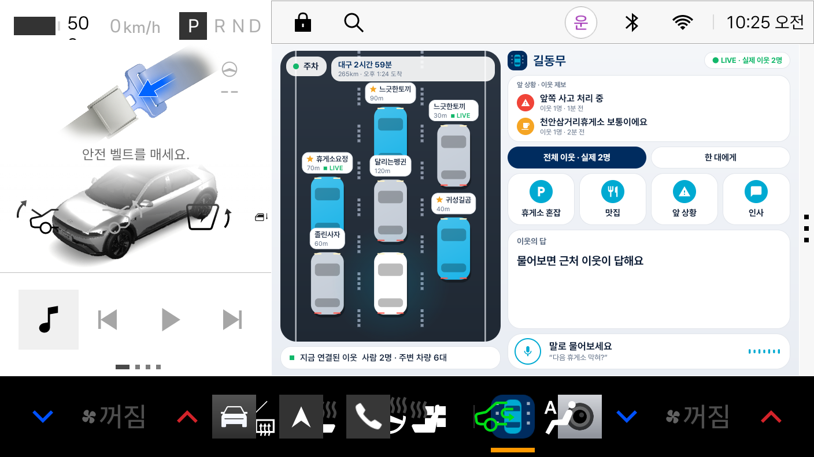
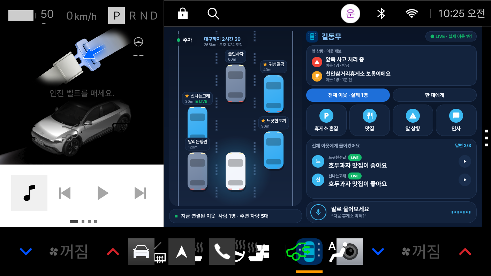
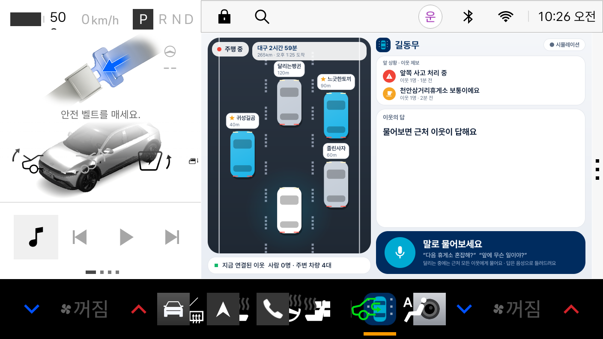
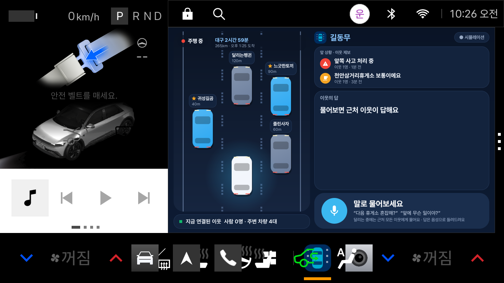

# 길동무

> 막힌 길 위에서, 근처 차에게 버튼 한 번(또는 말 한마디)으로 "앞에 뭐가 있어요?"를 묻는 차량용 앱

현대차·기아 **차량용 앱 개발 공모전**(Pleos App Market)에 참가하려고 만든 프로토타입입니다. 개인 참가(대학(원)생 부문).

| 정차 중 (낮) | 이웃 답변 (밤) | 주행 중 (낮) | 주행 중 (밤) |
|---|---|---|---|
|  |  |  |  |

## 왜 만들었나
명절에 고속도로에서 차가 서 버리면 앞에서 무슨 일이 있는지, 휴게소가 붐비는지 알 방법이 없습니다.
내비는 "사고가 있음", "휴게소가 여기 있음"까지만 알려 줍니다. 하지만 **"한 대 정리 중이라 곧 풀려요", "주차장이 만차예요"** 같은 현장 사정은 바로 앞에 있는 사람들이 압니다.
그래서 근처 차끼리 물어보고 답할 수 있게 만들었고, **한 사람이 답하면 그 정보가 근처 모든 차에 쌓이도록** 했습니다.

## 핵심 기능
- **앞 상황 카드:** 이웃이 알려 준 정보를 모아서 "앞쪽 사고 처리 중 · 이웃 2명 · 방금"처럼 보여 줍니다. 15분이 지난 제보는 사라집니다.
- **물어보기:** 휴게소 혼잡, 맛집, 앞 상황, 인사를 한 줄 타일로. 글자 입력은 없고 정해진 질문만 있습니다. 답은 **카드로 쌓이고(최대 3명), 각 카드에서 다시 들을 수 있으며**, 카드를 누르면 고마워요/신고가 나옵니다.
- **질문 범위 선택:** **전체 이웃**에게 물으면 최대 3명이 답하고 서로의 답이 보입니다. **한 대에게**를 고르면 도로에서 차를 눌러 그 차에게만 보냅니다(같은 차에게는 1분에 한 번).
- **연결 현황:** "지금 연결된 이웃 사람 N명 · 주변 차량 M대"를 보여 줍니다.
- **말로 질문:** "다음 휴게소 막혀?"라고 말하면 정해진 질문 중 하나로 바뀝니다. 말한 소리는 글자로만 바뀌어 쓰이고, 실제 목소리는 이웃에게 전달되거나 저장되지 않습니다. 이웃은 답을 기기의 합성 음성으로 듣습니다.
- **차량 제한을 따르는 화면:** 차량이 전면 제한을 알려 주면 **잠긴 버튼 대신 큰 음성 질문 화면**이 나오고, 그렇지 않으면 큰 타일 한 번 터치로 묻습니다.
- **내비 연동:** Pleos NaviHelper로 목적지, 남은 시간, 도착 예정 시각을 읽어 옵니다(조회 전용).
- **안전 장치:** 신고(차단), 건너뛰기, 잠시 쉬기(질문 받지 않기). 프로필은 **목록에서 고르기만** 해서(이름은 "형용사+동물", 색, 가는 곳) 글자를 입력하는 곳이 없고, 차종·가는 곳·칭호는 공개 여부를 끌 수 있습니다.
- **재미:** 답을 받으면 "고마워요"를 보낼 수 있고, 도움을 준 횟수에 따라 이웃 칭호가 오릅니다(새싹 → 단골 → 도로 위 박사).
- **디자인:** 현대의 남색(Hyundai Blue)과 하늘색을 쓰고, 차선과 대기 표시는 픽셀 모양입니다. 시스템 설정에 따라 **낮/밤 테마**가 바뀌고, 밤 화면은 유리 같은 카드와 은은한 빛 번짐으로 꾸몄습니다. 하단에는 항상 **말로 물어보는 막대**가 있습니다.

### 주행 상태와 터치 정책
화면의 상태 표시는 주차(기어 P) / 정차 중(P가 아니고 거의 멈춤) / 주행 중으로 나뉩니다. 하지만 **터치를 막을지는 속도가 아니라 차량 플랫폼이 알려 주는 제한 수준(CarUxRestrictions)** 으로 정합니다.

| 차량이 알려 주는 제한 | 앱의 동작 |
|---|---|
| 전면 제한(모든 플래그, 0x1FF) | 질문 타일을 접고 **큰 음성 질문 화면**만 보여 줍니다. 서버도 터치 질문을 거절하고 음성 질문만 받습니다. |
| 그 외 (예: 에뮬레이터에서 측정한 0x50 = 설정류와 동영상만 제한) | 속도와 상관없이 **큰 타일 한 번 터치**로 질문할 수 있습니다. 시선을 많이 쓰는 "한 대에게"(작은 차 누르기)는 주행 중에는 끕니다. |

글자 입력이 없고 큰 한 번 터치와 음성만 있어서, Pleos 설계 가이드의 "키보드보다 프리셋 선택과 음성 입력 우선"에 맞춘 구성입니다. 지역별 정책이 더 엄격한 차량에서는 플랫폼이 알려 주는 제한을 그대로 따릅니다.
입력창, 동영상, 설정이 없는 한 화면짜리라서 주행 중에도 쓸 수 있는 앱(distractionOptimized)으로 선언했습니다.
(속도 3km/h 같은 우리 숫자는 터치 판단에 쓰지 않습니다.)

## 실제로 연동한 것 / 아직 아닌 것
솔직하게 적어 둡니다.

| | 상태 |
|---|---|
| Pleos **NaviHelper** SDK (목적지, 남은 시간) | 연동함. 에뮬레이터에서 대구까지 경로를 걸고 확인 |
| 차량 주행 상태, 속도 (AAOS) | 연동함 |
| 서버 (근처 차량, 질문, 답, 신고, 프로필) | 직접 만든 Python 서버. 자동 테스트 34개 |
| **실제 사람 이웃** | **폰 브라우저**로 접속한 사람이 질문에 답하면 차 화면에 반영됨. 폰에서 시험함 |
| 나머지 이웃 차량 | **시뮬레이션** (실제 차량 여러 대로 시험하지 못함) |
| 휴게소, 맛집 정보 | 샘플 데이터. 공공데이터포털 API로 바꿀 예정 |
| 음성 | 앱은 안드로이드 음성 인식과 TTS를 사용. **에뮬레이터에는 음성 인식이 없어서 앱 안의 마이크 버튼은 에뮬레이터에서 확인하지 못함.** 같은 변환 과정은 PC 브라우저 시험 화면(`/ask`)에서 확인함. Pleos STT/TTS SDK는 콘솔에서 "준비 중"이라 쓰지 못함 |
| 진짜 Pleos 차량 | 시험하지 못함 |
| 차량 여러 대가 동시에 이 앱을 쓰는 구조 | 서버가 아직 "차 한 대 + 폰 이웃" 기준 |

## 실행 방법
### 1) 서버
Python 3.12 이상, 설치할 패키지 없음.
```
python server/app_server.py 8080
```
에뮬레이터에서는 `10.0.2.2:8080`으로 접속합니다. 서버가 꺼져 있으면 앱은 미리 넣어 둔 데모 답변으로 동작합니다.
같은 Wi-Fi의 폰에서 서버를 켠 PC 주소로 들어갈 수 있습니다.
- `http://<PC주소>:8080/neighbor` : **이웃 화면.** 프로필을 고르고 "이웃으로 참여"하면 질문이 오고, 버튼으로 답합니다.
- `https://<PC주소>:8443/neighbor` : 같은 화면에서 **말로 답하기**(브라우저가 마이크를 허용하는 보안 주소, 자체 인증서라 경고가 한 번 뜹니다).
- `http://localhost:8080/ask` : PC에서 **말로 질문 시험.** 질문이 어떻게 변환되고 답이 소리로 읽히는지 확인합니다.

### 2) 앱
Pleos Connect 에뮬레이터(API 34)에 설치합니다.
```
adb install -r "apk/개인_길동무_release.apk"
adb shell am start -n com.gildongmu.app/.MainActivity
```
Android Studio에서 열어서 실행해도 됩니다(`local.properties`에 `sdk.dir`가 필요). 앱 이름은 "길동무"입니다.

### 3) 주행 상태 바꿔 보기
Pleos Virtual Console(`adb forward tcp:8088 tcp:8088` 후 브라우저에서 `127.0.0.1:8088`)에서 기어를 D로 두고 ACCEL을 누르면 속도가 올라가서 주행 화면으로 바뀝니다.
내비 앱에서 목적지를 설정하면 상단에 남은 시간이 나옵니다. 밤 화면은 `adb shell cmd uimode night yes`로 볼 수 있습니다.

### 테스트
```
python -m unittest discover -s tests
```

## 테스트 환경
- Windows 11, Android Studio (Gradle, Kotlin)
- Pleos Connect Emulator 2.1.0 (Automotive 1408p landscape, Android 14 / API 34)
- NaviHelper 3.0.5 (Pleos Playground Maven)
- Python 3.12 (서버, 표준 라이브러리만 사용)
- 폰(안드로이드 크롬)과 PC 브라우저: 이웃 화면과 음성 시험

## APK 위치
`apk/개인_길동무_release.apk` (프로토타입이라 디버그 키로 서명했습니다)

## 폴더 구조
```
app/      안드로이드 앱 (Kotlin)  MainActivity, RoadView, Theme, NaviClient, ApiClient, VoiceInput, DrivingMonitor
server/   서버: core.py 기본 로직, live.py 실제 이웃/전체·개별 질문/신고/프로필/음성 변환,
          app_server.py HTTP, static/ 이웃 화면과 음성 시험 화면
tests/    서버 로직 테스트
demo/     시연 영상 만든 스크립트
tools/    빌드/에뮬레이터 조작 스크립트
apk/      제출용 APK
docs/     화면 캡처
```

## 개인정보와 안전
- 말한 소리는 저장하거나 전송하지 않고, 글자로 바꾼 뒤 정해진 질문으로만 쓰입니다. 서버는 음성 사용 횟수("이해함/못 알아들음")만 기록하고 말한 내용은 기록하지 않습니다.
- 실제 위치 좌표는 이웃에게 보이지 않고 대략의 거리만 보입니다.
- 질문, 답, 프로필이 모두 정해진 목록이라 욕설이나 광고가 들어갈 길이 없습니다. 부적절한 이웃은 신고하면 차단됩니다. 같은 차에게 반복해서 보내는 것도 막았습니다.
- 차량이 전면 제한을 알리면 터치 질문은 서버에서도 거절되고 음성 질문만 받습니다. 한국이 어느 지역 정책에 해당하는지, 소통(Social/Communication) 앱의 주행 중 허용 범위가 어디까지인지는 문서에서 확인하지 못해 설명회에서 문의할 예정입니다.

## 한계와 앞으로
- 이웃 대부분이 시뮬레이션이라 **실제 차량끼리의 통신은 검증하지 못했습니다.** 실제 서비스라면 차량 위치 수집 동의와 비식별 처리가 먼저 필요합니다.
- 공공데이터(공사 현황, 휴게소 날씨, 휴게소 혼잡도) 실제 연동과 제휴 식당 쿠폰 관리가 다음 작업입니다.
- 서버를 차량 여러 대가 동시에 쓰도록 바꿔야 합니다.
- 주차 상태에서 앱을 띄운 뒤 기어를 바꿨을 때 시스템이 앱을 막는 경우가 한 번 보였는데, 원인은 아직 못 찾았습니다.

## 글꼴
한글 글꼴은 [Pretendard](https://github.com/orioncactus/pretendard)(SIL Open Font License 1.1)를 사용했습니다.
