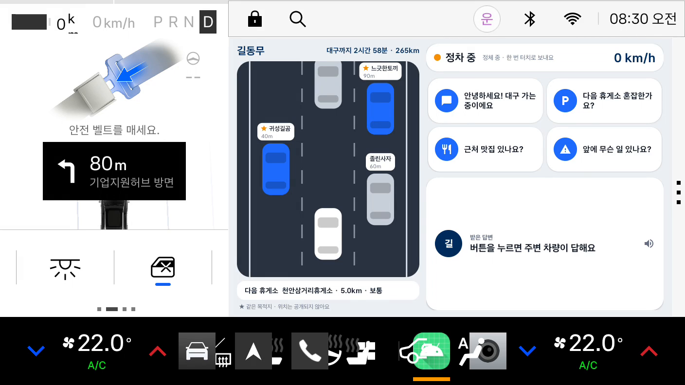
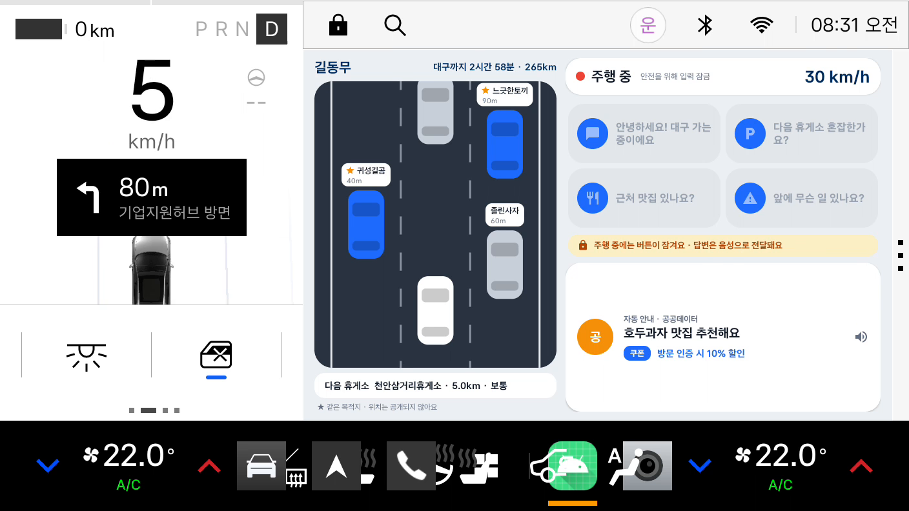

# 길동무

> 막힌 길 위에서, 근처 차에게 버튼 한 번으로 물어보는 차량용 앱

현대차·기아 **차량용 앱 개발 공모전**(Pleos App Market)에 참가하려고 만든 프로토타입입니다.
개인 참가 (대학(원)생 부문)

시연 영상: [docs/gildongmu_demo.mp4](docs/gildongmu_demo.mp4)

| 정차 중 | 답변·쿠폰 | 주행 중 |
|---|---|---|
|  |  |  |

## 왜 만들었나
명절에 고속도로에서 차가 서 버리면 앞에서 무슨 일이 있는지, 다음 휴게소가 붐비는지 알 방법이 없습니다.
내비는 길은 알려 주지만 "지금 저 앞에 있는 사람들이 보고 있는 것"은 알려 주지 않습니다.
그래서 근처에 있는 차끼리 물어보고 답할 수 있게 만들었습니다.

## 뭐 하는 앱인지
- **근처 차량 보기**: 도로 위에 내 차와 주변 차를 보여 줍니다. 같은 목적지로 가는 차는 파란색 + ★로 먼저 보입니다. 정확한 위치는 보여 주지 않고 대략의 거리만 보여 줍니다.
- **한 번 터치로 질문**: "다음 휴게소 혼잡한가요?", "근처 맛집 있나요?", "앞에 무슨 일 있나요?", 인사. 글자는 입력하지 않습니다.
- **답이 없으면 공공데이터가 대신 답**: 근처 차가 답하지 않으면 휴게소 정보나 맛집을 대신 알려 주고, 제휴 식당이면 쿠폰이 같이 나옵니다.
- **달리는 중에는 잠금**: 차가 움직이면 버튼이 잠기고, 앞 차 소식은 음성으로만 들려줍니다. 서버도 주행 중 전송을 거절합니다.
- **내비 연동**: 내비게이션에 설정된 목적지와 남은 시간을 읽어 와서 상단에 보여 줍니다.

### 주행 상태 기준
| 상태 | 기준 | 버튼 |
|---|---|---|
| 주차 | 기어 P | 사용 가능 |
| 정차 중 | P가 아니고 속도 3km/h 이하 (신호대기, 정체) | 사용 가능 |
| 주행 중 | 속도 3km/h 초과 | 잠김 |

차량 플랫폼이 알려 주는 주행 제한 상태(CarUxRestrictions)를 그대로 따랐고, 3km/h 기준만 앱에서 정했습니다.
화면은 입력창, 동영상, 설정이 없는 한 화면짜리라서 주행 중에도 쓸 수 있는 앱(distractionOptimized)으로 선언했습니다.

## 실제로 연동한 것 / 아직 아닌 것
솔직하게 적어 둡니다.

| | 상태 |
|---|---|
| Pleos **NaviHelper** SDK (목적지, 남은 시간) | 연동함. 에뮬레이터에서 대구까지 경로를 걸고 확인 |
| 차량 주행 상태 / 속도 (AAOS CarUxRestrictions, CAR_SPEED) | 연동함 |
| 서버 (근처 차량, 메시지, 답변) | 직접 만든 Python 서버. **이웃 차량은 시뮬레이션**입니다 (실제 차량 여러 대로 테스트하지 못함) |
| 휴게소·맛집 정보 | 샘플 데이터. 공공데이터포털 API로 바꿀 예정 |
| 음성 안내 | 안드로이드 기본 TTS. Pleos TTS/STT SDK는 콘솔에서 "준비 중"이라 쓰지 못함 |
| 상대 운전자가 음성으로 답하기 | 아직 없음 (STT SDK가 열리면 말한 내용을 정해진 답 문구로 바꿔 보내는 방식으로 하려고 함) |

## 실행 방법
### 1) 서버
Python 3.12 이상, 설치할 패키지 없음.
```
python server/app_server.py 8080
```
에뮬레이터에서는 `10.0.2.2:8080`으로 접속합니다. 서버가 꺼져 있으면 앱은 미리 넣어 둔 데모 답변으로 동작합니다.

### 2) 앱
Pleos Connect 에뮬레이터(API 34)에 설치합니다.
```
adb install -r "apk/개인_길동무_release.apk"
adb shell am start -n com.gildongmu.app/.MainActivity
```
Android Studio에서 열어서 실행해도 됩니다. (`local.properties`에 `sdk.dir`가 있어야 합니다.)

### 3) 주행 상태 바꿔 보기
Pleos Virtual Console(`adb forward tcp:8088 tcp:8088` 후 브라우저에서 `127.0.0.1:8088`)에서 기어를 D로 두고 ACCEL을 누르면 속도가 올라가고, 버튼이 잠기는 걸 볼 수 있습니다.
내비 앱에서 목적지를 설정하면 상단에 남은 시간이 나옵니다.

### 테스트
```
python -m unittest discover -s tests
```

## 테스트 환경
- Windows 11, Android Studio (Gradle, Kotlin)
- Pleos Connect Emulator 2.1.0 (Automotive 1408p landscape, Android 14 / API 34)
- Vehicle SDK / NaviHelper 3.0.5 (Pleos Playground Maven)
- Python 3.12 (서버, 표준 라이브러리만 사용)

## APK 위치
`apk/개인_길동무_release.apk` (프로토타입이라 디버그 키로 서명했습니다)

## 폴더 구조
```
app/      안드로이드 앱 (Kotlin)  MainActivity, RoadView, DrivingMonitor, NaviClient, ApiClient
server/   서버 (core.py 로직, app_server.py HTTP, simulator.py 가상 차량, schema.sql)
tests/    서버 로직 테스트
demo/     시연 영상 만든 스크립트
tools/    빌드/에뮬레이터 조작 스크립트
apk/      제출용 APK
docs/     시연 영상, 스크린샷
```

## 한계와 앞으로
- 이웃 차량이 시뮬레이션이라 실제 차량 간 통신은 검증하지 못했습니다. 실제 서비스라면 차량 위치 수집에 대한 동의와 비식별 처리가 먼저 필요합니다.
- 욕설·광고를 막으려고 질문과 답을 정해진 문구로만 주고받게 했고, 차단·신고 기능은 서버 로직까지만 만들어 두었습니다 (화면은 아직 없음).
- 공공데이터(휴게소 혼잡도, 주유소 가격, 관광 정보) 실제 연동과 제휴 식당 쿠폰 관리가 다음 작업입니다.
- 주행 중 전환 시 시스템이 앱을 막는 경우가 한 번 보였는데(주차에서 시작해 기어를 바꿨을 때), 원인은 아직 못 찾았습니다.

## 키·개인정보
Pleos 프로젝트 키는 코드와 저장소에 넣지 않았습니다. 현재 앱은 SDK 연동에 별도 키 없이 에뮬레이터에서 동작합니다.
